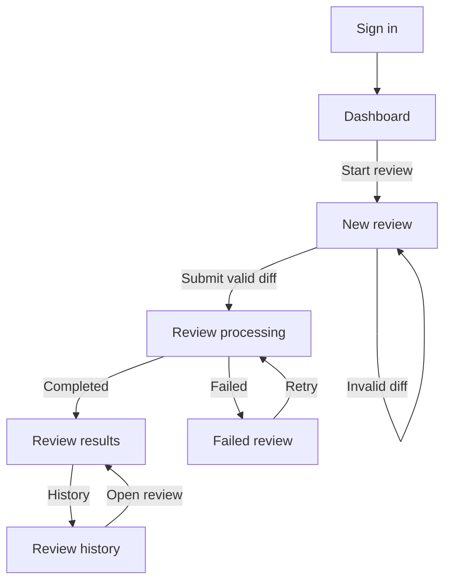
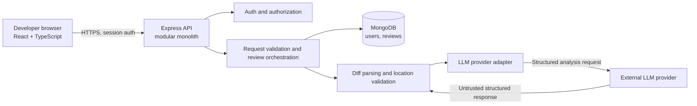

# PR Guardian — UX and System Design

**Status:** Draft for design validation  
**Milestone:** 02 · Design  
**Product brief:** [PRODUCT_BRIEF.md](PRODUCT_BRIEF.md)

## 1. Design goals and assumptions

- Make manual diff review the primary workflow. GitHub PR selection and comment posting remain later milestones.
- Use the blueprint's proposed stack: React + TypeScript + Vite, Node.js + Express + TypeScript, and MongoDB + Mongoose.
- Keep the backend a modular monolith. The API owns authentication, authorization, input validation, review state, persistence, and calls to the analysis provider.
- The browser never receives the LLM credential. Model output is untrusted until it passes schema and diff-location validation.
- The first version supports one signed-in developer per account. Private reviews are scoped to their owner.
- This design leaves the specific LLM vendor and hosting provider undecided for the research/technical-decision milestone.

## 2. User flow



## 3. Screen designs

The sketches show content hierarchy, not final styling. Every screen includes normal, loading, empty, and error behavior.

### A. Dashboard

```text
+-----------------------------------------------------+
| PR Guardian                              Account   |
| Dashboard   Review history                          |
+-----------------------------------------------------+
| Your code reviews                    [Start a review]|
| [Total]          [Completed]         [Needs attention]|
|                                                     |
| Recent reviews                                      |
| Status | Review title/source | Date | Findings | Open|
| ...                                                 |
+-----------------------------------------------------+
```

- **Normal:** Summary counts and recent reviews; primary action starts a manual review.
- **Loading:** Dashboard skeleton while summary and recent reviews load.
- **Empty:** Explain that no reviews exist and offer “Start a review.”
- **Error:** Show a recoverable message and retry loading the dashboard.

### B. New review

```text
+-----------------------------------------------------+
| New review                                          |
| Paste a unified diff                                 |
|                                                     |
| +-----------------------------------------------+   |
| |                                               |   |
| |             Diff editor / textarea            |   |
| |                                               |   |
| +-----------------------------------------------+   |
| Input guidance · size limit · validation feedback    |
|                                    [Review changes]  |
+-----------------------------------------------------+
```

- **Normal:** Diff input, format/size guidance, validation feedback, and submit action.
- **Loading:** Disable duplicate submission; show “Review in progress” and explain that the review is being analyzed. Keep the user on a status view that can recover after refresh.
- **Empty:** Blank textarea with an example hint; submit stays disabled until input is valid.
- **Error:** Inline validation for invalid/oversized input; API/provider failure is shown with a retry action when safe.

### C. Review results

```text
+-----------------------------------------------------+
| Review · Completed                    [Back to history]|
| Source: Manual diff   Created: date   Status: complete|
|                                                     |
| Findings (N)  [severity filters]                    |
| [Severity] Finding title             file:line       |
| Explanation / evidence                               |
| Suggested fix                                        |
| [Report as false positive]                           |
+-----------------------------------------------------+
```

- **Normal:** Review metadata and findings grouped by severity; each item shows title, explanation, evidence, suggested fix, and a location only when validated.
- **Loading:** While the review is pending/running, show progress state and refresh/poll status; do not imply a result exists yet.
- **Empty:** Completed review with zero findings says no actionable findings were returned; avoid claiming the diff is bug-free.
- **Error:** Failed review explains that analysis did not complete and offers retry when eligible. Unavailable/revoked reviews use a not-found or access-denied message without exposing private data.

### D. Review history

```text
+-----------------------------------------------------+
| Review history                         [Start review]|
| Search title/source   [Status filter] [Date filter]  |
| Status | Source/title | Created | Findings | Open     |
| ...                                                 |
| Previous / Next                                      |
+-----------------------------------------------------+
```

- **Normal:** Owner's reviews, newest first, with status, source/title, creation time, finding count, and open action; search/filter controls may be applied client-side initially or server-side as volume grows.
- **Loading:** Table skeleton while results load.
- **Empty:** No reviews yet or no matches for current filters; provide a clear reset or start-review action.
- **Error:** Explain that history could not load and provide retry.

## 4. System architecture



The API creates a review record before analysis, transitions its status, stores validated results, and returns the current review representation. For the MVP, analysis can run in the API process with explicit timeout and failure handling. A queue/worker is a later scale decision, not a foundation requirement.

## 5. Data model (MongoDB)

### User

| Field | Type | Notes |
|---|---|---|
| `_id` | ObjectId | Primary key |
| `email` | string | Required, normalized, unique index |
| `passwordHash` or identity-provider subject | string | Never store plaintext password; exact auth choice belongs to technical decisions |
| `createdAt`, `updatedAt` | Date | Audit timestamps |

### Review

| Field | Type | Notes |
|---|---|---|
| `_id` | ObjectId | Public API identifier |
| `ownerId` | ObjectId | Required reference to User; authorization boundary |
| `title` | string | Optional user label; can default to “Manual diff review” |
| `source` | enum | Initially `manual_diff`; future `github_pr` |
| `status` | enum | `queued`, `running`, `completed`, `failed` |
| `diff` | string | Submitted diff; private data, bounded by request size policy |
| `findings` | Finding[] | Validated findings; empty when none |
| `error` | object/null | Safe error code/message, never provider secrets or raw internals |
| `attempt` | number | Retry tracking/idempotency support |
| `createdAt`, `updatedAt`, `completedAt` | Date | Lifecycle timestamps |

Indexes: `{ ownerId: 1, createdAt: -1 }` for history; `{ ownerId: 1, _id: 1 }` for owner-scoped lookup. Email has a unique index. Avoid indexes without a supported query.

### Finding (embedded in Review)

| Field | Type | Notes |
|---|---|---|
| `severity` | enum | `critical`, `high`, `medium`, `low` |
| `category` | enum | `correctness`, `security`, `performance`, `maintainability` |
| `title` | string | Concise issue summary |
| `problem` | string | What may be wrong |
| `evidence` | string | Relevant diff evidence |
| `impact` | string | Why it matters |
| `suggestion` | string | Suggested fix |
| `location` | object/null | `{ filePath, startLine, endLine }`, only if verified against diff |
| `confidence` | number/null | Omit unless its meaning is defined and calibrated |

## 6. API contract (initial version)

All endpoints use `/api/v1`, require authentication except sign-in/sign-up, and return JSON. Every review read or mutation must include an owner filter on the server. Return `404` for a review that does not exist or is not owned by the caller to avoid disclosing its existence.

### Authentication

- `POST /auth/signup` — `{ email, password }` → `201 { user }`; validation/conflict errors use `400`/`409`.
- `POST /auth/login` — `{ email, password }` → `200 { user }` and establishes a secure session; invalid credentials → generic `401`.
- `POST /auth/logout` — clears session → `204`.
- `GET /auth/me` — current user → `200 { user }` or `401`.

Session cookie should be `HttpOnly`, `Secure` in production, and use an appropriate `SameSite` policy. CSRF protection and exact auth/session implementation are confirmed in technical decisions.

### Reviews

- `POST /reviews` — `{ title?, diff }` → `202 { review }` with status `queued` or `running`. Reject missing/non-diff/oversized input with `400`/`413`. Use a client-supplied idempotency key or equivalent retry guard so a network retry does not unintentionally start duplicate analysis.
- `GET /reviews?status=&limit=&cursor=` — caller's reviews, newest first → `200 { items, nextCursor }`.
- `GET /reviews/:id` — caller-owned review including status and findings → `200 { review }`; `404` if absent or not owned.
- `POST /reviews/:id/retry` — retry eligible failed review → `202 { review }`; reject non-failed/non-retryable state with `409`.

Review response shape:

```json
{
  "id": "review-id",
  "title": "Manual diff review",
  "source": "manual_diff",
  "status": "completed",
  "findings": [],
  "error": null,
  "createdAt": "ISO-8601 timestamp",
  "completedAt": "ISO-8601 timestamp"
}
```

Finding response shape:

```json
{
  "severity": "high",
  "category": "correctness",
  "title": "Handle empty input",
  "problem": "The change can ...",
  "evidence": "The changed code ...",
  "impact": "This may ...",
  "suggestion": "Check ... before ...",
  "location": { "filePath": "src/example.ts", "startLine": 18, "endLine": 18 }
}
```

Use a consistent error envelope: `{ "error": { "code": "VALIDATION_ERROR", "message": "Human-readable safe message", "requestId": "..." } }`. Do not return stack traces, credentials, or raw provider responses.

## 7. Security and failure behavior

- Enforce ownership on every review endpoint, not only in the UI.
- Validate diff type and maximum size before persistence/provider calls; exact limits are a technical decision.
- Keep LLM credentials server-side; redact secrets and avoid logging submitted source code by default.
- Treat model output as untrusted: validate schema, severity/category values, string lengths, and line/file references against the submitted diff; discard or mark unsupported locations.
- Bound provider timeouts and retries. Retry only eligible transient failures; avoid duplicate charge/work through idempotency and explicit attempt state.
- Never execute submitted code. Do not treat diff comments as model instructions.
- Return safe error codes and messages while retaining diagnostic details in protected server logs.

## 8. Design decisions to validate

1. Is manual diff submission the only input for the MVP, with GitHub PR flow postponed?
2. Is a single signed-in developer account model acceptable for the first version?
3. Should the initial review flow be asynchronous (`202` + status polling) as designed, or synchronous for simpler early development? The design chooses asynchronous because analysis latency is variable and the blueprint explicitly calls for clear processing states.
4. Are the finding fields and four screen states sufficient for the initial experience?
5. Are any screen, data, or API requirements missing before Foundation work begins?

## 9. Milestone completion check

Design is ready to complete when the four screens and their states, architecture, initial database model, and API contracts are accepted. No packages, application code, or external services are introduced in this milestone.
